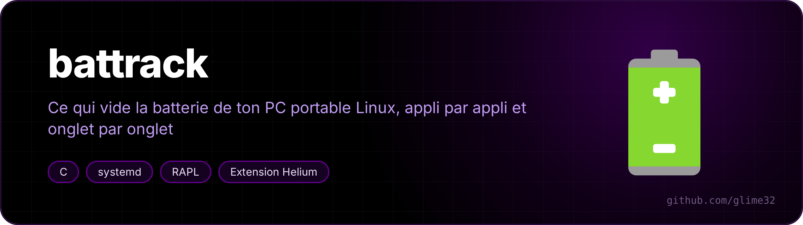
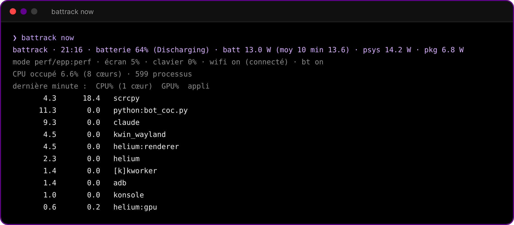
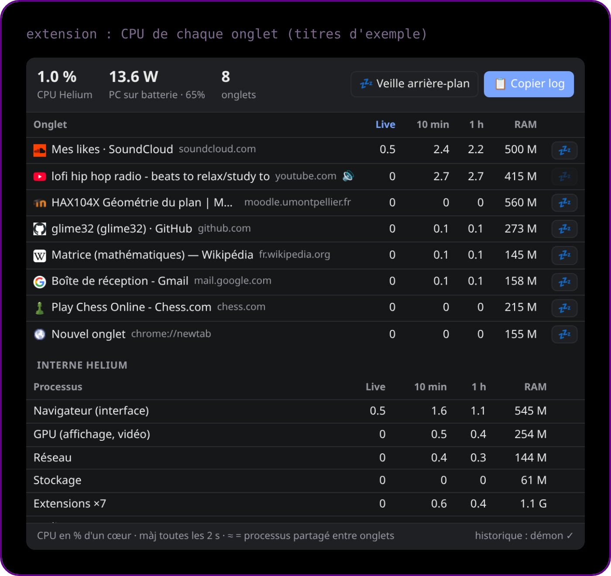

<p align="center"></p>

<p align="center">  </p>

Traqueur de conso ultra léger pour PC portable Linux, écrit en Rust (sans root, sans Python), et extension Helium/Chromium qui montre le CPU de chaque onglet.

<p align="center"><a href="README.md">🇬🇧 English version</a></p>

Le démon se réveille une fois par minute, lit `/proc` et `/sys`, et cumule par appli **et** par contexte (batterie / secteur). Une commande sort un rapport court à coller à Claude (ou à lire toi-même) pour trouver ce qui vide la batterie.

## Installer

```fish
curl -fsSL https://raw.githubusercontent.com/glime32/battrack/main/install.sh | bash
```

Ça compile, installe `~/.local/bin/battrack`, le démon systemd utilisateur, la mise à jour auto, l'hôte natif Helium et le lanceur KDE « Rapport batterie (copier) ».

Extension : `chrome://extensions` → **Mode développeur** → **Charger l'extension non empaquetée** → `~/battrack/extension`. Épingle l'icône bleue.

Facultatif, pour mesurer la conso **même branché** (RAPL lisible par ton groupe) :

```fish
echo 'ACTION=="add", SUBSYSTEM=="powercap", KERNEL=="intel-rapl:0|intel-rapl:1", RUN+="/usr/bin/chgrp '(id -gn)' /sys%p/energy_uj", RUN+="/usr/bin/chmod 0440 /sys%p/energy_uj"' | sudo tee /etc/udev/rules.d/99-rapl.rules
sudo udevadm control --reload && sudo udevadm trigger --action=add --subsystem-match=powercap
```

Compromis : lire l'énergie sans être root permet en théorie des attaques par canal auxiliaire (Platypus). Acceptable sur un PC perso.

<p align="center"><br><sub>battrack now : la dernière minute</sub></p>

<p align="center"><br><sub>l'extension : CPU de chaque onglet (titres d'exemple)</sub></p>

## Utiliser

| Quoi | Commande |
|---|---|
| Rapport court à envoyer à Claude | `battrack copy` (presse-papier) ou menu KDE « Rapport batterie (copier) » |
| Voir le rapport | `battrack report` |
| Dernière minute (watts, mode, top applis) | `battrack now` |
| Remettre à zéro (après une optimisation) | `battrack reset` |
| Coût du démon + puissance instantanée | `battrack bench` |

Extension : clic sur l'icône → CPU par onglet (live, 10 min, 1 h), RAM, watts du PC, 💤 pour endormir un onglet, **📋 Copier log**.

Veille auto (activée par défaut, réglage en bas du panneau) : sur batterie, un onglet en arrière-plan qui dépasse 4 % d'un cœur deux minutes de suite est endormi. Jamais l'onglet affiché, un onglet qui joue du son, un onglet épinglé ni les sites en exception (claude.ai, Meet, Zoom, Discord, YouTube Music, SoundCloud au départ ; 🚫 en ajoute un).

## Ce qui est mesuré

Tout est compté **deux fois en parallèle** : colonne BATTERIE et colonne SECTEUR.

- par appli : CPU, GPU (3D + vidéo, pilote xe), réveils/s, part estimée de la conso (W~)
- processus trop brefs pour être vus : retrouvés par cgroup (`[courts] konsole`, `[courts] claude-code`…), IRQ à part
- scripts sans nom (`python3 -c`, heredoc) : nommés d'après qui les lance, par ex. `python3:-c [claude]`
- puissance : batterie, RAPL psys (PC entier, marche aussi branché, hors temps de charge) et package (CPU+GPU+RAM), repos, p10/p90
- dans le temps : luminosité, écran éteint, rétroéclairage clavier, wifi/bluetooth allumés, wifi connecté,
  mode énergie (platform_profile + EPP) avec les watts moyens de chaque mode
- système : C-états, GPU au repos, veille (conso et part en sommeil matériel S0ix), sessions batterie, autonomie (et « si débranché » côté secteur)
- config au moment du rapport : profil, EPP, écran Hz, wifi power-save, PCI runtime PM, démons connus, cmdline noyau
- Helium : chaque processus est relié à son onglet (`--renderer-client-id` = `processId` de `webNavigation`)

## Coût

- Démon : 1 réveil / minute, ~4 ms CPU par réveil (≈ 0,007 % d'un cœur), ~3 Mo RAM,
  SCHED_IDLE + nice 19, timer slack 2 s, écriture disque toutes les 15 min sur batterie (le reste en RAM).
- Extension : panneau fermé, la veille auto se réveille une fois par minute sur batterie, une fois toutes les 5 min sur secteur (juste le temps de lire l'état de la batterie). Panneau ouvert : une lecture de /proc toutes les 2 s.
- Mise à jour auto : un `git fetch` par heure.

## Mise à jour auto

`battrack-maj.timer` tourne 2 min après l'ouverture de session puis toutes les heures. S'il y a du nouveau sur `main`, il avance le dépôt, recompile, relance le démon (seulement si le programme a changé) et envoie une notification. Des modifications locales bloquent la mise à jour : rien n'est écrasé.

L'extension est chargée depuis le dépôt, ses fichiers se mettent donc à jour tout seuls (rouvre le panneau). Si `manifest.json` change, clique « recharger » dans `chrome://extensions`.

## Fichiers

- état : `~/.local/state/battrack/state.tsv` · live : `$XDG_RUNTIME_DIR/battrack/` (en RAM)
- veilles : `~/.local/state/battrack/veilles.tsv`, une ligne par veille d'une minute ou plus (fin, durée, sommeil profond, Wh, W, ce qui a réveillé, ce qui était branché)
- services : `~/.config/systemd/user/battrack.service`, `battrack-maj.service`, `battrack-maj.timer`
- hôte natif : `~/.config/net.imput.helium/NativeMessagingHosts/com.glime.battrack.json`

## Désinstaller

```fish
~/battrack/uninstall.sh          # --tout efface aussi l'historique
```

Testé sur Lenovo Yoga 7 2-in-1 14ILL10 (Core Ultra 7 258V, GPU xe), CachyOS, KDE Plasma 6 (Wayland), Helium.

## Licence

MIT
