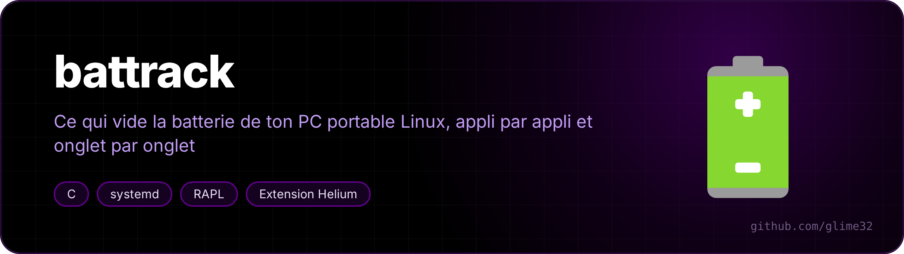
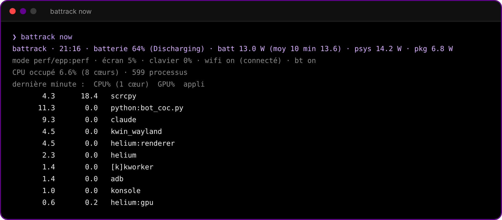
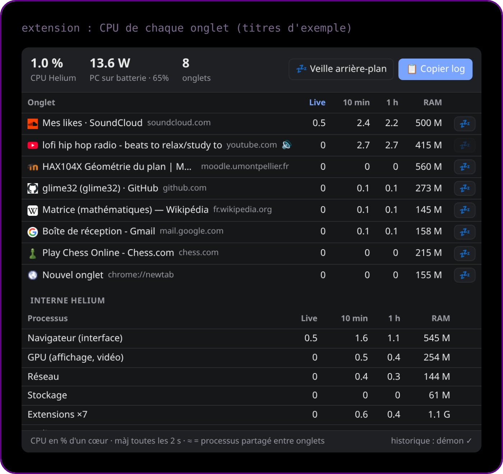

<p align="center"></p>

<p align="center">  </p>

Ultra-light power tracker for Linux laptops, written in C (no root, no Python), plus a Helium/Chromium extension that shows CPU per tab.

<p align="center"><a href="README.fr.md">🇫🇷 Version française</a></p>

The daemon wakes up once a minute, reads `/proc` and `/sys`, and keeps totals per app **and** per context (on battery / plugged in). One command prints a short report you can paste to Claude (or read yourself) to find what drains the battery.

## Install

```sh
curl -fsSL https://raw.githubusercontent.com/glime32/battrack/main/install.sh | bash
```

It builds and installs `~/.local/bin/battrack`, a systemd user service, the auto-update timer, the Helium native messaging host and a KDE launcher.

Extension: `chrome://extensions` → **Developer mode** → **Load unpacked** → `~/battrack/extension`.

Optional, to measure power **while plugged in** (RAPL readable by your group):

```sh
echo 'ACTION=="add", SUBSYSTEM=="powercap", KERNEL=="intel-rapl:0|intel-rapl:1", RUN+="/usr/bin/chgrp '"$(id -gn)"' /sys%p/energy_uj", RUN+="/usr/bin/chmod 0440 /sys%p/energy_uj"' | sudo tee /etc/udev/rules.d/99-rapl.rules
sudo udevadm control --reload && sudo udevadm trigger --action=add --subsystem-match=powercap
```

Trade-off: unprivileged energy readings make power side channels (Platypus) possible. Fine on a personal laptop.

<p align="center"><br><sub>battrack now: the last minute</sub></p>

<p align="center"><br><sub>the extension: CPU per tab (sample tab titles)</sub></p>

## Use

| What | Command |
|---|---|
| Short report to paste | `battrack copy` (clipboard) or the KDE launcher |
| Show the report | `battrack report` |
| Last minute (watts, mode, top apps) | `battrack now` |
| Reset counters (after a tweak) | `battrack reset` |
| Daemon cost + instant power | `battrack bench` |

Extension: click the icon → CPU per tab (live, 10 min, 1 h), RAM, laptop watts, 💤 to discard a tab, **📋 Copy log**.

Auto-sleep (on by default, toggle at the bottom of the popup): on battery, a background tab above 4 % of a core for two minutes in a row is discarded. Never the visible tab, a tab playing sound, a pinned tab or an excepted site (claude.ai, Meet, Zoom, Discord, YouTube Music, SoundCloud to start with; 🚫 adds one).

## What it measures

Everything is counted **twice, side by side**: a BATTERY column and a PLUGGED-IN column.

- per app: CPU, GPU (3D + video, xe driver fdinfo), wakeups/s, estimated share of power (W~)
- power: battery, RAPL psys (whole platform, works on AC too) and package (CPU+GPU+RAM), idle floor, p10/p90
- over time: screen brightness, screen off, keyboard backlight, wifi/bluetooth on, wifi connected,
  power mode (platform_profile + EPP) with average watts per mode
- system: C-states, S0ix, GPU idle, suspend drain, battery sessions, runtime estimate
- config at report time: profile, EPP, refresh rate, wifi power save, PCI runtime PM, known daemons, kernel cmdline
- Helium: each process is mapped to its tab (`--renderer-client-id` = `webNavigation` `processId`)

## Cost

- Daemon: one wakeup per minute, ~2 ms CPU each (≈ 0.004 % of a core), ~0.5 MB RAM,
  SCHED_IDLE + nice 19, 2 s timer slack, disk write every 15 min on battery (live data stays in RAM).
- Extension: popup closed, auto-sleep wakes once a minute on battery and once every 5 min on AC (just long enough to read the battery state). Popup open: one /proc read every 2 s.
- Auto-update: one `git fetch` per hour.

## Auto-update

`battrack-maj.timer` runs 2 min after login, then hourly. When `main` moved, it fast-forwards the checkout, rebuilds, restarts the daemon (only if the binary changed) and shows a notification. Local changes block the update; nothing is overwritten.

The extension is loaded from the checkout, so its files update in place (reopen the popup). If `manifest.json` changes, click reload in `chrome://extensions`.

## Uninstall

```sh
~/battrack/uninstall.sh          # --tout also deletes the history
```

Tested on a Lenovo Yoga 7 2-in-1 14ILL10 (Core Ultra 7 258V, xe GPU), CachyOS, KDE Plasma 6 (Wayland), Helium.

## License

MIT
